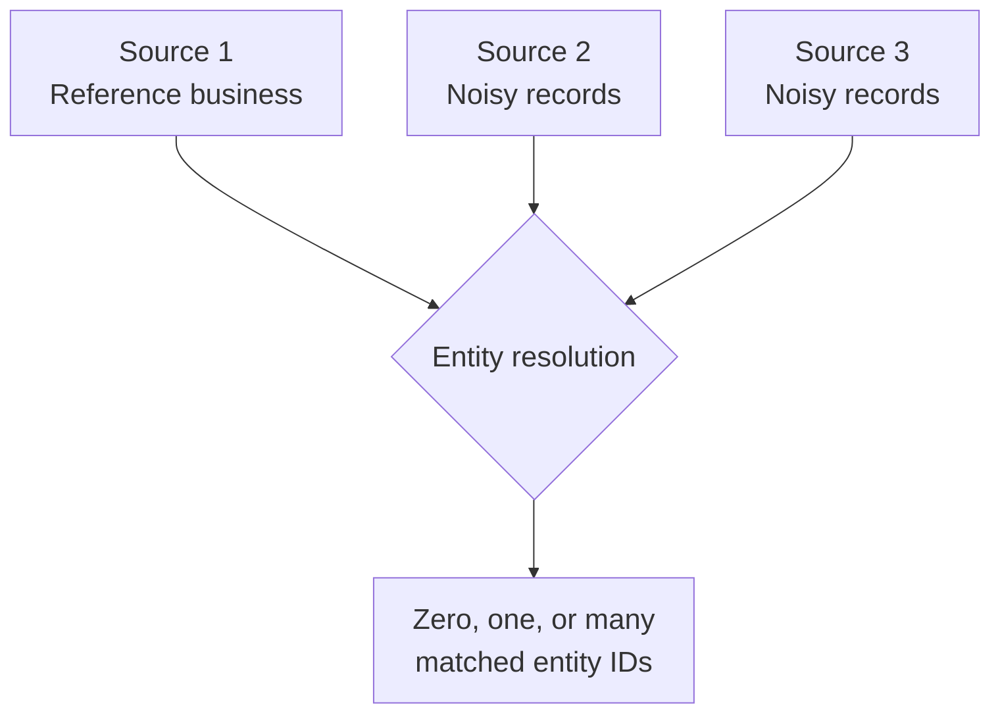
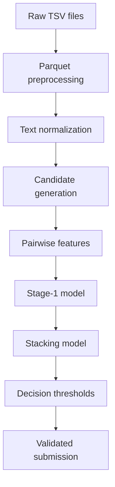
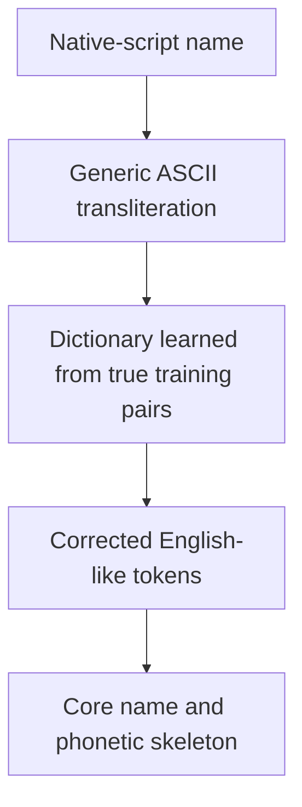
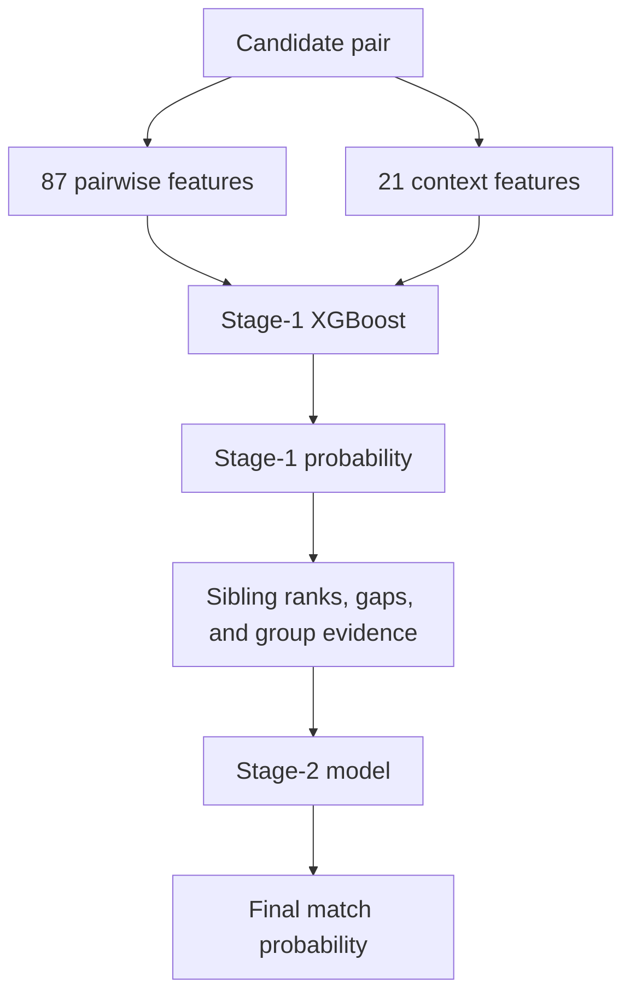
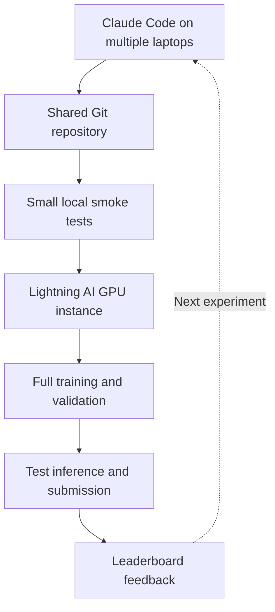

## Introduction

I had already received an on-campus placement offer in August 2026. Because the
main placement pressure was over, I decided to try the Amazon ML Challenge and use
the three-day contest to test how well I could build a large machine learning
system under a real deadline.

In simple terms, the challenge gave us one clean list of businesses and two messy
lists. We had to find which records in the messy lists referred to each business
in the clean list.

> Given one clean list of businesses and two noisy lists, find every record that
> refers to the same real-world business.

The lists did not share a common identifier. The same business could have a
misspelled name, a shortened address, different word order, or a name written in
another language. Some businesses had several matching records, while others had
no match at all.

I participated under the team name **Flipkart**, representing the National
Institute of Technology Karnataka (NITK), Surathkal. We finished with a score of
**0.969642** and a final leaderboard rank of **#1882**.
The public explorer preserved 17 leaderboard snapshots. Its last historical
checkpoint showed us at **#1813**, while the finalized team profile later settled
at **#1882**.

<div class="row mt-3">
  <div class="col-sm-12 mt-3 mt-md-0">
    
  </div>
</div>

<div class="caption">
My final Amazon ML Challenge 2026 team result: a score of 0.969642 and finalized
rank #1882.
</div>

This post explains the problem from the beginning, the scale of the dataset, what
we built on each day, the mistakes we made, how cloud GPUs and coding agents
helped, and how the score improved from **0.551736 to 0.969642**.

The complete implementation is available in our
[GitHub repository](https://github.com/saketjha34/Amazon-ML-Challenge-2026).

## The Challenge: Business Entity Resolution

The challenge provided three independent business-data sources:

| Source   | Role                                                      |
| -------- | --------------------------------------------------------- |
| Source 1 | Deduplicated reference businesses                         |
| Source 2 | Noisy records that had to be linked to Source 1           |
| Source 3 | Another independent noisy source to be linked to Source 1 |

Every record contained four primary fields:

- `entity_id`
- `business_name`
- `business_address`
- `country`

For every Source 1 entity, we had to predict all matching entity IDs from Sources
2 and 3. A Source 1 business could have zero, one, or many matches.

Conceptually, the required mapping looked like this:



### Dataset Scale

The data was large enough that comparing every Source 1 record with every Source
2 and Source 3 record was impossible.

| Split |      Source 1 |     Source 2 |     Source 3 |
| ----- | ------------: | -----------: | -----------: |
| Train |  ~2.2 million | ~5.0 million | ~5.3 million |
| Test  | ~1.73 million | ~4.9 million | ~5.1 million |

That means the training split contained roughly **12.5 million records (1.25
crore)** and the test split roughly **11.73 million records (1.17 crore)**. In
other words, we were working with close to **2.4 crore records across train and
test**, before even generating candidate pairs.

The raw package was organized around these files:

| File                     | Purpose                                                |
| ------------------------ | ------------------------------------------------------ |
| `train_source1.tsv`      | Deduplicated reference businesses used for training    |
| `train_source2.tsv`      | First noisy source containing matches and distractors  |
| `train_source3.tsv`      | Second noisy source containing matches and distractors |
| `train_ground_truth.tsv` | Source 1 ID to comma-separated true target IDs         |
| `test_source1.tsv`       | Reference businesses for final inference               |
| `test_source2.tsv`       | First test target source                               |
| `test_source3.tsv`       | Second test target source                              |

### A Small Example

Consider this simplified, fictional example:

| Source   | Entity ID | Business name                  | Business address                | Country |
| -------- | --------- | ------------------------------ | ------------------------------- | ------- |
| Source 1 | `S1_001`  | Shree Balaji Medicals Pvt Ltd  | 12 MG Road, Bengaluru           | India   |
| Source 2 | `S2_901`  | Sri Balaji Medicos             | 12 Mahatma Gandhi Rd, Bangalore | India   |
| Source 3 | `S3_144`  | Balaji Medical Private Limited | MG Road, Bengaluru 12           | India   |
| Source 2 | `S2_777`  | Balaji Medicals                | 48 MG Road, Bengaluru           | India   |

The first two target records probably describe the Source 1 business. The last
record is a dangerous distractor: its name is almost identical, but its house
number is different.

An ideal prediction would be:

```text
source1_entity_id	matched_entity_ids
S1_001	S2_901,S3_144
```

However, the matching model could not compare `S1_001` against all target records
directly. Candidate generation first produced a smaller set, possibly including
all three example targets:

```text
source1_entity_id	candidate_entity_id
S1_001	S2_901
S1_001	S3_144
S1_001	S2_777
```

The model then had to keep `S2_901` and `S3_144` while rejecting `S2_777`.

### Intended Output

The output contained two TSV files:

1. `matching_results.tsv` with the final matches.
2. `candidate_pairs.tsv` with the exact candidates passed to the matching model.

The second file made candidate generation a first-class part of the evaluated
system. It was not enough to train a good classifier the true pair had to enter
the candidate set before the classifier could ever find it.

This split created two separate objectives:

1. **Candidate generation needed high recall.** Missing a true target here made
   recovery impossible.
2. **Final matching needed high precision.** The F0.5 metric punished false links
   more heavily than missed links.

### What Made the Data Difficult

The same business could appear in several forms:

- legal suffixes such as `Pvt Ltd`, `LLC`, `Inc`, `SARL`, or `SAS`;
- abbreviations and reordered words;
- spelling mistakes and OCR-like character substitutions;
- missing landmarks, cities, or house numbers;
- native-script names paired with English names;
- several highly similar businesses at nearby addresses;
- deliberately confusing distractor records that belonged to no Source 1 entity.

France made the problem even more interesting. The training data contained the US
and India, but France appeared only in the test set. We therefore could not build a
closed country solution or hard code rules that worked only on the training
countries.

## Understanding the Metric

The competition used entity-level, macro-averaged \(F\_{0.5}\):

$$
F_{\beta} = (1 + \beta^2)\frac{\text{precision} \times \text{recall}}
{\beta^2 \times \text{precision} + \text{recall}}
$$

For \(\beta=0.5\):

$$
F_{0.5} = 1.25\frac{\text{precision} \times \text{recall}}
{0.25\times\text{precision} + \text{recall}}
$$

Precision mattered more than recall. A false match was therefore especially
expensive. The score was computed separately for every Source 1 entity and then
averaged, so large businesses with many matches could not dominate the metric.

Singletons were also important. If a business had no true match and we predicted
nothing, it received an entity score of 1. If we attached even one false record to
it, its score became 0.

```python
def compute_entity_f05(pred_ids, true_ids):
    if not true_ids and not pred_ids:
        return 1.0
    if not true_ids and pred_ids:
        return 0.0
    if true_ids and not pred_ids:
        return 0.0

    tp = len(pred_ids & true_ids)
    fp = len(pred_ids - true_ids)
    fn = len(true_ids - pred_ids)

    precision = tp / (tp + fp)
    recall = tp / (tp + fn)
    return (1.25 * precision * recall) / (0.25 * precision + recall)
```

This metric shaped almost every later decision. We needed high candidate recall,
but the final matching layer had to be conservative.

## The Journey in One Graph

The public history captured four distinct phases:

1. We started at **0.551736**.
2. The first working end-to-end pipeline jumped to **0.956897**.
3. Better retrieval and matching pushed the score to **0.968696**.
4. After a temporary regression, our final submission reached **0.969642**.

<div class="row mt-3">
  <div class="col-sm-12 mt-3 mt-md-0">
    
  </div>
</div>

<div class="caption">
Score progression across 17 recorded leaderboard checkpoints. The explorer labels
the chart “F1”, while the challenge metric was Macro F0.5.
</div>

The graph makes the progress look like three jumps, but each jump came from a
collection of experiments. Our repository's run history gives the more useful
technical view:

| Run           | Main change                                                  | Validation F0.5 |                                 Leaderboard |
| ------------- | ------------------------------------------------------------ | --------------: | ------------------------------------------: |
| `run_50k_v2`  | Strong lexical baseline                                      |          0.9684 |                                           — |
| `run_100k_v1` | XGBoost and stacking                                         |          0.9693 |                                       0.948 |
| `run_100k_v2` | Context features                                             |          0.9745 | 0.953, then 0.9597 with stricter thresholds |
| `run_50k_v3`  | Transliteration, reverse retrieval, and distractor awareness |          0.9832 |                                      0.9687 |
| `run_70k_v1`  | Target-duplicate features                                    |      **0.9835** |                                 **0.96964** |
| `run_70k_opt` | Optuna-tuned XGBoost                                         |          0.9831 |                                     0.96937 |

The run table and explorer snapshots are not a one-to-one mapping: the explorer
records public leaderboard states, while the repository also contains local
validation experiments and threshold variants. Together, however, they show the
same engineering arc.

## Day 1: Data Brief, Preprocessing, and the First Submission

The contest ran for three days, from September 25 to September 27, 2026. On the
first day, our priority was to understand the data and submit a complete baseline
as early as possible. We could not spend hours optimizing a model before knowing
whether preprocessing, inference, output generation, and validation worked
together.

We identified three immediate constraints:

1. A Cartesian comparison between millions of Source 1 and target records was
   impossible.
2. Names and addresses required multilingual, open-set normalization.
3. Candidate generation had to preserve true matches before a classifier could
   help us.

At this stage I used **Gemini through Antigravity** as a coding assistant. It was
helpful for boilerplate and quick notebook experiments, but our early workflow
still consisted of fragmented ideas rather than a measured, reusable pipeline.

Our first goal was not sophistication. It was to create a complete pipeline that
could:

1. read millions of records;
2. normalize names and addresses;
3. generate a manageable number of candidate pairs;
4. calculate similarity features;
5. train a classifier;
6. produce valid submission files.

The first score, **0.551736**, told us that completing the pipeline was not the
same as solving the problem. But it gave us something more valuable than a pile of
isolated notebooks: an end-to-end system we could measure and improve.



### Preprocessing for Repeated Experiments

The preprocessing notebook converted the raw TSV files into Parquet and created
reusable columns such as:

- normalized name and address text;
- name and address tokens;
- string and token lengths;
- extracted address numbers and house number;
- normalized country, state, and city.

This was not only a data cleaning step. During a 72 hour challenge, repeatedly
parsing raw text wastes precious time. Parquet files, cached normalization, and
DuckDB joins let later experiments start from stable intermediate data.

### Normalizing Multilingual Business Records

Exact string equality was far too brittle, but blindly applying fuzzy matching
was also dangerous. We needed representations that removed irrelevant variation
while preserving the details that distinguished two businesses.

For each name, the normalizer created:

- `name_t`: cleaned and transliterated text;
- `name_core`: the name after removing legal-form tokens;
- `name_key`: sorted unique core tokens;
- `name_skel`: a phonetic consonant skeleton.

For addresses, it standardized abbreviations, states, and house numbers while
retaining numeric evidence.

```python
def normalize_frame(df):
    names = df["business_name"].fillna("").astype(str).tolist()
    addrs = df["business_address"].fillna("").astype(str).tolist()

    is_native = [1 if has_non_latin(n) else 0 for n in names]
    name_t = [
        apply_translit(_prep_name(n)) if native else _prep_name(n)
        for n, native in zip(names, is_native)
    ]
    name_core = [core_name(n) for n in name_t]
    name_key = [" ".join(sorted(set(n.split()))) for n in name_core]
    name_skel = [skeleton(n) for n in name_core]
    addr_t = [canon_addr(a) for a in addrs]
```

#### Learning Transliteration from the Training Data

Generic ASCII transliteration was not enough. For example, an Indian script
business name might be transliterated phonetically but still fail to match its
English version.

We learned a token level transliteration dictionary from the training ground
truth. When a native script target and its English Source 1 match had aligned
tokens, repeated high confidence alignments became correction rules. The process
used only the supplied training data no external entity lookup.



This change raised the share of native script true pairs with a name token set
score of at least 90 from **5.7% to 95.7%**. It was one of the clearest examples
of error analysis turning directly into a measurable improvement.

## Day 2: Candidate Retrieval, Features, and the Matching Models

On Day 2, I moved much of the implementation workflow to **Claude Code**. That
switch coincided with a major improvement in iteration speed: it became easier to
trace behavior across modules, convert notebook experiments into production code,
and debug changes that affected blocking, features, training, and inference
together.

This is a personal observation rather than a controlled comparison of AI tools,
but during the contest, teams with access to stronger paid coding agents such as
GPT and Claude appeared to iterate faster than teams relying only on free
assistants. The advantage was not a one-prompt winning solution. It was the
ability to implement, test, inspect, and discard more serious experiments during
the same three-day window.

Our first mature pipeline moved the public score to **0.956897**. The repository
shows why the remaining work was difficult: precision rose quickly, but recall
became the bottleneck. For example, `run_100k_v1` achieved **0.9945 precision**
and **0.9312 recall**. Further classifier tuning could not recover true pairs that
the candidate generator never retrieved.

### Candidate Generation Became the Real Bottleneck

Even a perfect classifier cannot recover a true match that never reaches it.
Candidate generation therefore set a hard upper bound on our score.

Our blocking system combined several retrieval strategies:

- exact name and address keys;
- name key plus house number;
- name key plus city;
- phonetic skeleton keys;
- character n-gram TF-IDF retrieval for names;
- character n-gram TF-IDF retrieval for addresses;
- combined name-and-address retrieval.

Candidates were partitioned by country and capped per Source 1 entity. This cut an
otherwise impossible search space down to a set that could be scored by the
matching model.

### Why Character N-Grams Helped

Character n-grams tolerate small spelling differences, missing spaces, and local
reordering better than whole-word equality. We used hashed sparse vectors and
top-K cosine retrieval for scalability.

The blocking score blended the strongest signal with the average evidence:

```python
best = np.maximum(np.maximum(addr, name_sim), combo)
avg = 0.45 * addr + 0.35 * name_sim + 0.20 * combo

score = (
    0.5 * best
    + 0.5 * avg
    + 0.15 * exact_name
    + 0.15 * exact_addr
)
```

When an address was missing, the ranking logic replaced missing address evidence
with name evidence instead of treating the missing field as a zero. Otherwise,
valid name only matches were often ranked out of the candidate cap.

### Reverse Retrieval

Normal retrieval asked: “For this Source 1 business, which target records are
closest?” That direction sometimes failed when the Source 1 name was short or
generic.

We added the reverse question: “For this target record, which Source 1 businesses
are closest?” Each target's best five Source 1 records became additional
candidates.

Reverse retrieval recovered **31.5% of the true links missed by plain forward
retrieval**. With the v3 approach, the blocking recall ceiling rose to roughly
**0.988**.

### From Fuzzy Scores to 87 Pairwise Features

Candidate generation optimized recall. The classifier then had to reject the
large number of plausible but incorrect pairs.

The pairwise feature extractor produced 87 features across several families:

| Feature family           | Examples                                    | What it captured                         |
| ------------------------ | ------------------------------------------- | ---------------------------------------- |
| Fuzzy text similarity    | ratio, partial ratio, token-set, token-sort | Misspellings and word reordering         |
| Exact normalized matches | core, key, skeleton, address                | High confidence equality                 |
| Token overlap            | Jaccard and overlap ratios                  | Shared name/address content              |
| Numeric evidence         | number overlap and relative difference      | House and address consistency            |
| Location evidence        | state and city agreement                    | Geographic compatibility                 |
| Retrieval evidence       | cosine scores, ranks, gaps                  | Strength relative to other candidates    |
| Legal forms              | match, conflict, one missing                | LLC/Inc and SARL/SAS distinctions        |
| Frequency priors         | target-name and Source 1 frequencies        | Whether a name was common or distinctive |
| Candidate-group features | sibling counts and margins                  | Competition within one Source 1 entity   |

Jaro-Winkler and legal form features were especially useful for similar businesses
whose core names looked nearly identical. A legal form conflict could be more
informative than another small increase in fuzzy similarity.

### Context Changed the Question

Pairwise matching asks:

> How similar is this Source 1 record to this target record?

But difficult entity resolution requires a second question:

> Is this target a better match for another Source 1 business?

We added 21 context features in two main groups.

#### Distinctive-Token Evidence

Not all shared words carry equal information. Matching on a rare business token is
stronger evidence than matching on words such as `services`, `road`, or `company`.
IDF weighted name and address features measured:

- weighted cosine similarity;
- weighted Jaccard similarity;
- important tokens missing from the target;
- suspicious extra tokens in the target.

#### Rival-Business Evidence

Reverse retrieval also gave us each target's strongest competing Source 1
businesses. We compared the current pair against those rivals. If another Source 1
record explained the target much better, the current match probability should
fall.

#### Target-Duplicate Evidence

The final `run_70k_v1` added six signals measuring whether other Source 2 or Source
3 records supported the candidate:

- same name key and house number;
- same exact address;
- same name key and city;
- same name skeleton and house number;
- same name/house key in the other source;
- same address in the other source.

This was based on a powerful observation. Real records often had independent
supporting variations, while distractors tended to be isolated perturbations.

- About **32%** of real records shared a name key and house number with another
  target, compared with only **1.2%** of distractors.
- About **43%** of real records shared an exact address, compared with **4.6%** of
  distractors.

This context helped the model answer not just “Do these strings look similar?” but
“Does the rest of the dataset support this identity?”

### XGBoost and Two-Stage Stacking

The first stage model was an XGBoost binary classifier. Gradient boosted trees fit
the problem well because the feature set mixed continuous similarities, binary
conflicts, ranks, counts, and missing-value patterns.

The second stage stacking model used the first model's probabilities together
with the structure of all candidates belonging to the same Source 1 entity.



Stacking let the model reason about relative confidence. A probability of 0.90
means something different when the next candidate is 0.89 than when every other
candidate is below 0.10.

#### Training on the Right Negatives

The test set contained a larger proportion of unowned target records than the
training data roughly 40% versus 26%. These distractors created false positives,
which were especially costly under F0.5.

We increased the training weight of negatives involving targets owned by no
Source 1 business by a factor of **1.9**. This made the model more cautious around
the exact records most likely to damage precision.

## Day 3: Full-Scale Training and the Final Leaderboard Push

By Day 3, the problem was no longer “Can the pipeline learn a useful matcher?” It
was “Can we run the strongest version on the largest feasible data, improve
candidate recall, control false positives, and finish inference before the
deadline?”

The later system combined multilingual normalization, forward and reverse
retrieval, 87 pairwise features, 21 context features, XGBoost, a stacking stage,
distractor aware weighting, exclusive target assignment, and two decision
thresholds. Each addition increased compute as well as modeling complexity.

### The Decision Layer Mattered as Much as the Model

A single threshold of 0.5 was not appropriate. The best candidate for an entity
and its additional matches had different risk profiles, so we used two thresholds:

- `t1` for the highest scoring candidate;
- `t2` for every additional candidate.

```python
def accept_mask(decisions, t1, t2, max_matches_per_s1=10):
    probability = decisions["prob"].values
    rank = decisions["s1_rank"].values

    return (
        np.where(rank == 0, probability >= t1, probability >= t2)
        & (rank < max_matches_per_s1)
    )
```

We also enforced exclusive targets: a Source 2 or Source 3 record could belong to
at most one Source 1 entity, keeping only its highest probability assignment.

### Why Validation-Optimal Thresholds Were Not Final

The leaderboard behaved as if test contained more distractors than validation.
Thresholds that maximized the plain validation score were too permissive.

We therefore ran a two dimensional threshold sweep while counting each false
positive twice during threshold selection. The unweighted validation optimum was
still recorded, but the weighted sweep produced a more conservative submission.

For the final run, the score moved as follows:

| Decision configuration         | Leaderboard score |
| ------------------------------ | ----------------: |
| Validation-selected thresholds |           0.96755 |
| Stricter thresholds            |           0.96958 |
| `t1 = 0.75`, `t2 = 0.985`      |       **0.96964** |

This was an important lesson: improving the classifier is not the only way to
improve an entity resolution system. The final decision policy must match the
metric and the deployment distribution.

### The Regression Before the Final Submission

The score timeline contains an uncomfortable but useful moment. After reaching
**0.968696**, a later leaderboard state dropped back to **0.956897**. The explorer
does not identify which code variant generated an individual snapshot, so it
would be misleading to attach that drop to one specific commit.

What the history does prove is that our progress was not monotonic. A locally
reasonable experiment or threshold choice could still make the public score
worse. We had to return to measured evidence, compare candidate recall, precision,
and entity level F0.5, and avoid keeping an idea merely because it sounded smart.

The final recovery added **0.012745**, taking the score to **0.969642**.

<div class="row mt-3">
  <div class="col-sm-12 mt-3 mt-md-0">
    
  </div>
</div>

<div class="caption">
Rank progression across the recorded checkpoints. The last recorded snapshot was
#1813; the finalized profile later displayed rank #1882.
</div>

### Why the Candidate Dataset Became So Large

The raw dataset already contained close to 2.4 crore records across train and
test, but training happened on **pairs**, not individual business rows. Every
Source 1 entity could generate dozens of candidates from exact blocking, TF-IDF
retrieval, reverse retrieval, and both target sources.

The configured cap was 80 candidates per Source 1 entity. Therefore, the 1.73
million test queries had a theoretical upper bound of roughly **138 million candidate pairs** before later pruning. Even a 50,000-entity training experiment
produced around **3.4 million pair rows** in the documented runs. Every pair then
needed dozens of fuzzy, numeric, retrieval, legal-form, group, and context
features.

This expansion was why a normal laptop was useful for development and smoke tests
but insufficient for our largest training and inference runs. The reproducible
final configuration in the repository trained on 70,000 Source 1 entities, while
test inference still processed all 1.73 million Source 1 queries against the full
target sources.

### Cloud GPU Workflow

For the full-scale experiments, we used **Lightning AI cloud GPUs**, including
NVIDIA **A100 and H100 GPUs**. Lightning AI provided approximately **80 GPU-hours
of free credits**, while the main cloud training and full test inference cycle
used roughly **10 hours** of GPU time.

We also explored AWS and Google Cloud, but GPU instances were not immediately
available. Both platforms required quota or access requests to be reviewed before
the required accelerators could be provisioned. During a three-day contest, that
approval delay made them impractical, so Lightning AI became our primary compute
platform.

Our working pattern was:



We used Claude Code on multiple laptops against the same codebase, synchronized
changes through Git, validated them on smaller samples, and moved only the stable
experiments to the cloud GPU. This avoided wasting expensive GPU time on syntax
errors, broken schemas, or ideas that had not passed a smoke test.

### Engineering the Pipeline for Millions of Records

The modeling ideas would not matter if the pipeline could not finish. The full
system used:

- Parquet for reusable columnar data;
- DuckDB for fast filtering and joins;
- sparse hashed vectors for text retrieval;
- CuPy and GPU top-K cosine search when available;
- chunked feature extraction and inference;
- controlled CPU worker counts;
- checkpoints after expensive stages;
- run-specific folders for models, metrics, candidates, and submissions.

The development machine documented in the repository had 16 GB RAM, a 6 GB RTX
4050 Laptop GPU, and 20 CPU threads. The final 70,000-entity training run took
about 45 minutes, validation around 3 minutes, and reused test blocking allowed
full scoring in roughly 45 minutes. These are implementation-specific timings,
not universal benchmarks.

Every expensive phase was resumable. Re-running a command after a crash reused
completed checkpoints, and `--init-from` could hard-link compatible artifacts
from an earlier run. This made it possible to experiment with models or feature
sets without repeating hours of blocking work.

## Final Results

The final `run_70k_v1` achieved:

| Metric                  |       Result |
| ----------------------- | -----------: |
| Validation Macro F0.5   |   **0.9835** |
| Validation precision    |   **0.9984** |
| Validation recall       |   **0.9555** |
| Blocking recall ceiling |   **0.9882** |
| Final leaderboard score | **0.969642** |
| Final leaderboard rank  |    **#1882** |

The Optuna-tuned run scored slightly lower 0.9831 on validation and 0.96937 on the
leaderboard so we kept the manually configured final model. Automated tuning was
useful, but it did not replace careful feature, retrieval, and distribution-shift
analysis.

## Project Structure

The final repository separated orchestration, data access, retrieval, feature
engineering, modeling, and evaluation instead of keeping the complete solution in
one notebook.

```text
Amazon-ML-Challenge-2026/
├── data-preprocessing.ipynb   # raw TSV to normalized Parquet preparation
├── config.py                  # paths, blocking, model and threshold settings
├── run_pipeline.py            # train, validate, test and decide CLI
├── Documentation_template.md  # final methodology and results
├── requirements.txt
├── docs/
│   ├── PROBLEM_STATEMENT.md
│   └── TEST_TIMING.md
├── src/
│   ├── data_loader.py         # loading, splits and ground truth
│   ├── text_norm.py           # multilingual name/address normalization
│   ├── blocking.py            # exact, TF-IDF and reverse candidate retrieval
│   ├── gpu_topk.py            # GPU sparse top-K similarity
│   ├── features.py            # 87 pairwise features
│   ├── context.py             # 21 rival/token/duplicate features
│   ├── model.py               # XGBoost/LightGBM matching model
│   ├── stacking.py            # stage-2 group-aware features
│   ├── metrics.py             # entity F0.5 and threshold search
│   ├── tuner.py               # Optuna hyperparameter tuning
│   ├── pipeline.py            # end-to-end phase orchestration
│   └── run_manager.py         # checkpoints and reusable run artifacts
└── utils/
    └── validate_submission.py # official output validation
```

This structure mattered during the contest. A normalization experiment could be
changed without rewriting model code, and a new model could reuse previously
generated candidate and feature checkpoints.

## Complete Tech Stack

| Area              | Technologies                                 | Role in the solution                             |
| ----------------- | -------------------------------------------- | ------------------------------------------------ |
| Language          | Python 3.11                                  | Complete ML and data pipeline                    |
| Data processing   | Pandas, NumPy, PyArrow                       | DataFrames, arrays, and Parquet storage          |
| Query engine      | DuckDB                                       | Fast filtering and joins over Parquet            |
| Sparse retrieval  | scikit-learn, SciPy, `sparse-dot-topn`       | Hashed TF-IDF and top-K cosine matching          |
| String matching   | RapidFuzz, Jaro-Winkler-style features       | Name and address similarity                      |
| Transliteration   | `anyascii` plus learned corrections          | Native-script normalization                      |
| Models            | XGBoost, LightGBM                            | Pair classification and stacking                 |
| Tuning            | Optuna                                       | Bayesian hyperparameter search                   |
| GPU compute       | CuPy, CUDA, NVIDIA A100/H100 on Lightning AI | Sparse top-K retrieval and XGBoost training      |
| Local development | Jupyter, VS Code, Git                        | EDA, experiments, collaboration, and versioning  |
| AI coding agents  | Gemini/Antigravity, Claude Code, GPT         | Rapid implementation, refactoring, and debugging |
| Cloud attempts    | Lightning AI, AWS, Google Cloud              | Full-data training and inference capacity        |

The final solution did not depend on one library or one model. It was a pipeline
in which data layout, retrieval, feature computation, model training, thresholds,
and hardware all had to fit together.

## Reproducing the Final Submission

The repository exposes the complete workflow through `run_pipeline.py`:

```bash
# Train the final model
python run_pipeline.py --mode train --sample-size 70000 \
  --train-split 0.85 --run-name run_70k_v1 \
  --model-type xgboost --device cuda --cpu-threads 12

# Validate and select thresholds
python run_pipeline.py --mode val --run-name run_70k_v1 \
  --device cuda --cpu-threads 12

# Score the complete test set
python run_pipeline.py --mode test --run-name run_70k_v1 \
  --device cuda --cpu-threads 12

# Apply the final leaderboard-calibrated decision rule
python run_pipeline.py --mode decide --t1 0.75 --t2 0.985 \
  --run-name run_70k_v1 --cpu-threads 12
```

The final outputs are `matching_results.tsv` and `candidate_pairs.tsv`. The
official validation script checks entity coverage, IDs, schema, duplicates, and
the relationship between the candidate and matching files before submission.

## What We Learned

### 1. Candidate recall is a hard ceiling

Once the true pair is absent from the candidate set, no classifier can recover it.
Improving retrieval from forward blocking to reverse retrieval was more valuable
than repeatedly tuning the same matcher.

### 2. Context beats isolated similarity on difficult pairs

Two strings can look similar and still represent different businesses. Rival
Source 1 records, rare token evidence, and duplicate support helped distinguish a
real identity from a convincing distractor.

### 3. Precision-heavy metrics change the whole system

F0.5 did not merely change the evaluation function. It affected negative
weighting, exclusive assignment, two level thresholds, and our willingness to
leave an entity unmatched.

### 4. Multilingual problems need data-driven normalization

Generic transliteration created readable strings but not necessarily matching
strings. Learning corrections from the supplied ground truth closed a major
failure mode without using prohibited external data.

### 5. A failed submission is still evidence

The temporary score regression forced us to separate intuition from measurement.
Every change needed to survive held-out evaluation, candidate recall analysis, and
the precisionrecall trade-off.

### 6. Reproducible engineering creates room for modeling

Caching, checkpoints, deterministic run folders, and reusable artifacts are not
secondary concerns. They determine how many serious experiments a team can run
under a hard deadline.

## Suggestions for Future Competitors

### Arrange Cloud GPU Access Before the Contest

If you plan to participate in a large ML competition, do not wait until the
dataset is released to request GPU access. AWS and Google Cloud commonly require
quota increases or manual approval before high-end accelerators become available.
That process can take longer than the competition itself.

Before the event begins:

- activate the cloud account and billing profile;
- request GPU quotas in the required regions;
- confirm that A100, H100, or an appropriate alternative can actually be started;
- prepare a second provider in case the preferred region has no capacity;
- test dataset upload, environment installation, checkpoint download, and
  restart behavior;
- estimate the storage needed for raw data, features, candidate pairs, models,
  and submissions.

Cloud GPU access was not optional for our complete workflow. Candidate pairing
expanded millions of raw entities into millions and potentially tens of
millions—of feature rows. Securing compute beforehand would have removed a major
source of risk.

### Submit a Baseline Early

The first submission does not need to be impressive. It needs to verify that the
entire path from raw files to validated output works. Our early `0.551736` score
gave us a stable point from which to measure every later idea.

### Measure Retrieval Separately from Classification

Always report candidate recall alongside precision, recall, and F0.5. If candidate
recall is the bottleneck, changing XGBoost parameters will not solve the actual
problem.

### Keep Expensive Work Reusable

Cache normalized data, retrieval indexes, candidate pairs, feature matrices, and
model checkpoints. Make every phase resumable. Under a short deadline, avoiding a
repeated two-hour computation is itself a competitive advantage.

### Use AI Coding Agents as Engineering Multipliers

Claude Code, GPT, and Gemini helped us move faster, but generated code still
needed to be understood, profiled, and validated. The best workflow was to give an
agent a measurable objective, review the diff, run a small test, and only then
move the experiment to the GPU.

### Maintain One Shared Workflow

When the same repository is used from multiple laptops and cloud instances, keep
configuration, commands, run names, and result files consistent. A strong model
is not useful if nobody can identify which code, thresholds, or artifacts produced
the submitted score.

## Conclusion

We began with a score of **0.551736** and a basic question: can we produce a valid
end-to-end submission? We ended with a score of **0.969642** and a much deeper
understanding of entity resolution.

The biggest improvements did not come from one magical model. They came from
systematically removing bottlenecks:

- normalize multilingual text better;
- retrieve true pairs before trying to classify them;
- compare candidates against their rivals;
- train against the distractors that matter;
- calibrate the final decision for a precision-heavy metric;
- keep every experiment reproducible.

That progression from a working pipeline to a carefully measured system is what
made the Amazon ML Challenge 2026 memorable for us.

You can explore the complete implementation, configuration, and experiment notes
in the
[Amazon ML Challenge 2026 repository](https://github.com/saketjha34/Amazon-ML-Challenge-2026),
and view the public leaderboard history on the
[Amazon ML Challenge Explorer](https://amazonmlchallengeexplorerv2.vercel.app/teams/59214265).

## References

1. [Complete Amazon ML Challenge 2026 solution repository](https://github.com/saketjha34/Amazon-ML-Challenge-2026)
2. [Challenge problem statement](https://github.com/saketjha34/Amazon-ML-Challenge-2026/blob/main/docs/PROBLEM_STATEMENT.md)
3. [Final methodology and experiment documentation](https://github.com/saketjha34/Amazon-ML-Challenge-2026/blob/main/Documentation_template.md)
4. [Team score and leaderboard history](https://amazonmlchallengeexplorerv2.vercel.app/teams/59214265)
5. [XGBoost documentation](https://xgboost.readthedocs.io/)
6. [LightGBM documentation](https://lightgbm.readthedocs.io/)
7. [Optuna documentation](https://optuna.readthedocs.io/)
8. [DuckDB documentation](https://duckdb.org/docs/)
9. [RapidFuzz documentation](https://rapidfuzz.github.io/RapidFuzz/)
10. [CuPy documentation](https://docs.cupy.dev/)
11. [Lightning AI documentation](https://lightning.ai/docs/)
